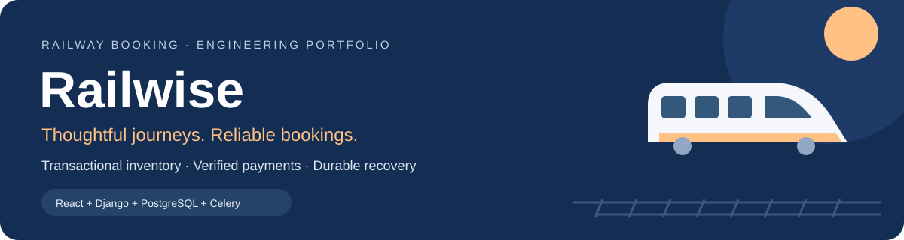
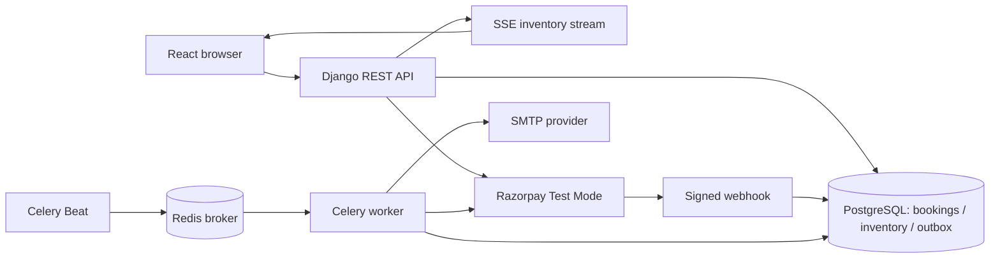

# Railwise



[](https://github.com/Shazil81/Railwise/actions/workflows/ci.yml)
[](docs/VALIDATION.md)
[](docs/VALIDATION.md)
[](docs/contention-results.json)

**A railway booking portfolio project built around scarce inventory, payment uncertainty and recoverable workflows.**

**Explore:** [Problems solved](#problems-solved) · [Tech stack](#tech-stack) · [Architecture](#architecture) · [Local setup](#run-locally) · [Test evidence](#tests-and-evidence)

Railwise lets guests discover saved Indian train routes, compare class fares and then sign in to book. The backend owns the demo inventory: it allocates berths, holds them during checkout, verifies payment evidence and reconciles cancellations/refunds asynchronously.

> Independent portfolio demo. Timetables are saved snapshots; fares and seat inventory are simulated. Tickets are not valid for travel. No runtime railway API is required.

## Problems solved

> **Core result:** 100 competing requests for one seat produced **1 successful hold and 99 rejected conflicts** in the local PostgreSQL contention benchmark. [See the measured results and scope](docs/VALIDATION.md).

### Reliable inventory under contention

**Prevent overlapping reservations.** Journey-level transaction locks and a PostgreSQL exclusion constraint protect the same seat even when competing requests arrive together. Multi-passenger bookings allocate atomically, while adjacent route legs can reuse capacity.

### Recoverable checkout and payments

**An abandoned browser must not strand inventory or decide payment truth.** Holds expire after ten minutes; server verification, signed webhooks and periodic reconciliation recover missing callbacks. Late captures queue refunds rather than restoring an expired reservation.

### Clear cancellation and refund tracking

**A cancellation click is only the beginning of a refund.** Durable requests, idempotent provider calls and background reconciliation track Requested → Processing → Processed. The interface distinguishes provider processing from independently verified bank credit.

| Challenge | Solution in Railwise | User benefit |
| --- | --- | --- |
| **Double booking** | Journey locks + PostgreSQL GiST exclusion constraint | One active reservation per overlapping seat segment |
| **Unused capacity between stops** | Half-open route intervals `[from_seq, to_seq)` | Adjacent legs can reuse the same seat |
| **Abandoned checkout** | Deadline-aware holds and expiry reconciliation | Inventory becomes available again |
| **Lost payment callback** | Verified webhooks + periodic provider checks | Recoverable payment status |
| **Late payment after cancellation** | Durable refund queue + idempotent requests | Refund processing can resume after interruptions |
| **Partial group reservation** | Atomic passenger allocation | All requested seats or no partial reservation |
| **Different city terminals** | Offline terminal groups + booking confirmation | Actual boarding/arrival stations stay explicit |

The project demonstrates these engineering problems; it does not claim they are unhandled defects in the real IRCTC system.

## Tech stack


| Layer | Technologies | Responsibility |
| --- | --- | --- |
| **Frontend** | React, TypeScript, Vite, React Router, Lucide | Responsive search, passenger forms, checkout and booking management |
| **API** | Python, Django, Django REST Framework | Validation, ownership, fare calculation and reservation workflows |
| **Database** | PostgreSQL | Transactional inventory, segment constraints and durable records |
| **Background jobs** | Celery worker, Celery Beat, Redis | Scheduled hold expiry, payment/refund reconciliation and email delivery |
| **Payments & tickets** | Razorpay Test Mode, ReportLab | Verified test transactions and server-generated PDF tickets |
| **Development & CI** | Docker Compose, GitHub Actions | Local dependencies and automated regression checks |

**Deployment preparation:** Nginx, Gunicorn and systemd templates are included. Public hosting has not been deployed.

## User experience

- Guest search by station/city/code, calendar, nearby terminals, filters and sorting.
- Local train catalogue and server-calculated class/quota/distance fares.
- Live inventory counts over Server-Sent Events.
- Up to six passengers, class-specific berth preferences, confirmed-only and opt-in upgrade preferences.
- Separate passenger and fare-review pages; coach/seat appears after confirmed payment.
- Razorpay Test Mode, recoverable payment status, cancellation preview and refund tracking.
- Confirmed booking PDF with journey times, class, passengers, coach/seat and payment details.
- Email verification, password reset and verified-owner booking notifications.
- Staff operations dashboard with scoped permissions and notification retry audit.

## Architecture



PostgreSQL is the inventory authority. Redis is a background-task broker, not the correctness boundary for seat allocation. All mutations follow the same journey-first lock order. External payments/refunds are reconciled using durable records; a browser success screen alone cannot confirm a booking.

## Run locally

Prerequisites: Python 3.13+, Node 22+, PostgreSQL and Redis (Docker Compose can run the latter two). Configure one database consistently for the API and workers. If port 5432 already belongs to your PostgreSQL installation, use that database or explicitly choose another port instead of starting a competing container.

```powershell
python -m venv backend/venv
backend/venv/Scripts/Activate.ps1
python -m pip install -r backend/requirements-dev.txt
Copy-Item backend/.env.example backend/.env
# Edit DB credentials and generate your own SECRET_KEY in backend/.env.
python backend/manage.py migrate
python backend/manage.py seed_data
python backend/manage.py createsuperuser
python backend/manage.py runserver 127.0.0.1:8000
```

In another terminal:

```powershell
npm ci --prefix frontend
npm run dev --prefix frontend
```

Open http://localhost:5173. Sign up through the UI, or create a non-staff demo account with the documented setup command. No shared admin password is included. Seed data preserves existing users/bookings and does not reset passwords. Search supports a rolling 60-day boarding-date window and bundled service running days.

Set fresh Razorpay **test** credentials, a separate webhook secret and SMTP settings in the ignored backend environment file to exercise provider integrations. Do not put secrets into frontend variables. Search/pricing/holds work independently of Razorpay and SMTP.

### Background processing

On Windows, with Docker Desktop and your database running:

```powershell
./scripts/notifications.ps1 -Action start -DbHost 127.0.0.1 -DbPort 5432 -DbName irctc -DbUser irctc
./scripts/notifications.ps1 -Action status
./scripts/windows-startup.ps1 -Action install
```

Despite the legacy script name, the launcher runs **operations mode**: one supervised worker consumes email + default queues; beat schedules notification delivery, hold expiry and payment/refund recovery. Exactly one beat should run. See [background services](docs/BACKGROUND_SERVICES.md).

## Tests and evidence

```powershell
python backend/manage.py test bookings --settings=railway_core.test_settings --noinput
npm test --prefix frontend
npm run lint --prefix frontend
npm run build --prefix frontend
```

Run database suites serially against PostgreSQL. Django creates an isolated test database; never point load generators at a shared booking database. The 100-attempt contention benchmark is reproducible with:

```powershell
$env:RAILWISE_BENCHMARK_REPORT = "$PWD/docs/contention-results.json"
python backend/manage.py test bookings.test_load --settings=railway_core.test_settings --noinput
```

[Validation report](docs/VALIDATION.md) distinguishes automated tests, browser verification, measured local contention and checks still requiring a real reboot/deployment. Local service-call latency is not HTTP throughput or a production capacity promise.

## Portfolio walkthrough

1. Search PNBE → HWH for a future service date; compare classes and actual terminals.
2. Add two fictional passengers and berth preferences; review the backend-calculated fare.
3. Complete a Razorpay test payment. Show confirmed coach/seat details and download the PDF.
4. Cancel before departure; show the refund preview and asynchronous status progression.
5. Explain the exclusion constraint, atomic group allocation, hold expiry and callback-loss recovery.
6. Present the contention report and explain its limits.

Use fictional data in public screenshots/video. Previous screenshots containing contact/payment records are intentionally excluded from publishing.

## Documentation

- [Architecture and data model](docs/ARCHITECTURE.md) · [interview guide](docs/ENGINEERING.md)
- [Offline catalogue](docs/RAILWAY_DATA.md) · [seeded routes](docs/LOCAL_ROUTES.md)
- [Automatic booking](docs/AUTOMATIC_BOOKING_FLOW.md) · [reservation rules](docs/RESERVATION_RULES.md)
- [Payment lifecycle](docs/PAYMENT_LIFECYCLE.md) · [PDF tickets](docs/TICKETS.md)
- [Operations dashboard](docs/OPERATIONS.md) · [email delivery](docs/BOOKING_EMAILS.md)
- [Deployment, TLS, backups and monitoring](docs/DEPLOYMENT.md)
- [Demo recording script and resume wording](docs/PORTFOLIO.md)

## Scope

Saved timetables can age and catalogue coverage is finite. Availability belongs to this app, pricing is illustrative, and refunds in Test Mode do not move real money. Berth preferences are requests, and no official PNR is issued. Deployment templates require a chosen host/domain and environment-specific checks.

[License](LICENSE)
