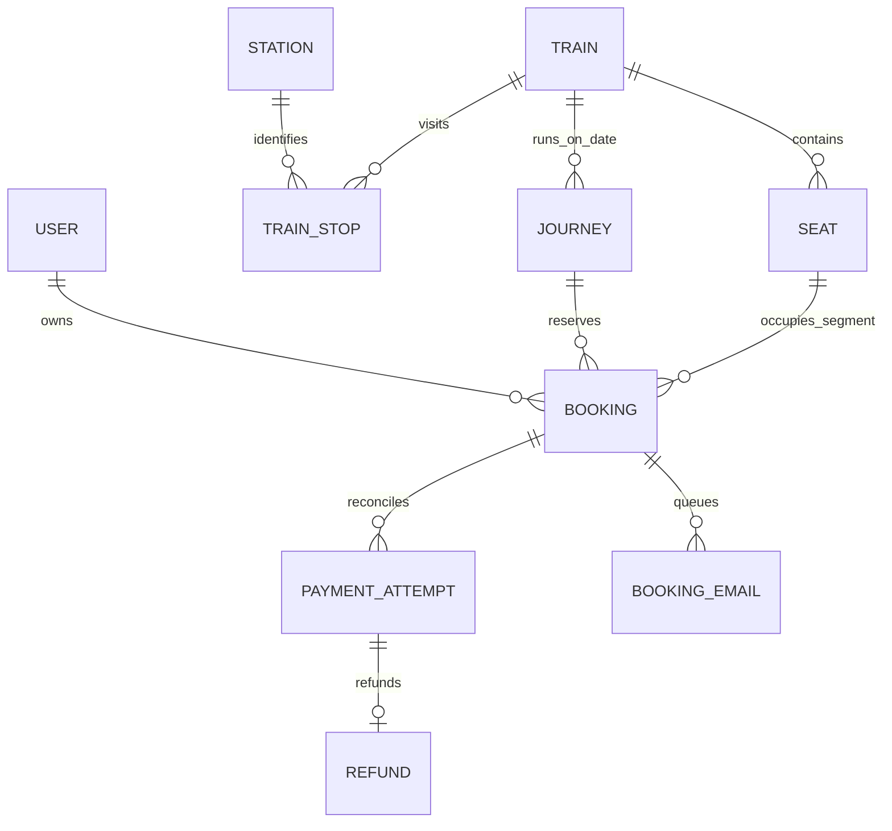

# Architecture and data model

Bookings store half-open route intervals, fares and passenger details. Group members
link to a root booking so payment/cancellation can cover the whole group. Public
search uses local train/station/stop data; own-seat availability is never presented
as official Indian Railways inventory.

## Allocation boundary

Django opens a PostgreSQL transaction and locks the journey before mutating seats,
holds, waitlists or payments. Queries inspect overlapping active intervals. A GiST
exclusion constraint rejects overlapping occupancy independently of the service.
Adjacent segments may reuse a seat. This chooses straightforward correctness and
lock ordering over parallel writes within a single journey; a hot journey can be a
throughput bottleneck, as the local benchmark intentionally demonstrates.

## Payment boundary

The server freezes a fare snapshot for the hold and creates a gateway order. A
client callback is evidence to verify, not authority to mark paid. Provider fetches
and signed webhooks reconcile attempts. Cancellation/expiry followed by a late
capture queues an idempotent refund instead of resurrecting the reservation.
Periodic recovery resumes from durable DB records after lost callbacks/tasks.

## Delivery boundary

Celery Beat sends periodic work to Redis. Workers read the database outbox and
reconcile payment/refund state with the provider. Email notification delivery is
retried with recorded status. SMTP acceptance cannot prove inbox placement, and
provider refund processing cannot independently prove bank credit.

## Deployment boundary

Nginx terminates HTTPS, serves React and proxies API/admin/SSE to Django. API and
Celery workers share PostgreSQL/Redis configuration. One beat runs per environment.
Production settings enforce explicit host/secret/HTTPS configuration and shared
Redis throttling cache. No browser receives backend provider secrets.

See DEPLOYMENT.md for service templates and backup/monitoring steps, and
VALIDATION.md for measured checks and remaining real-environment verification.
